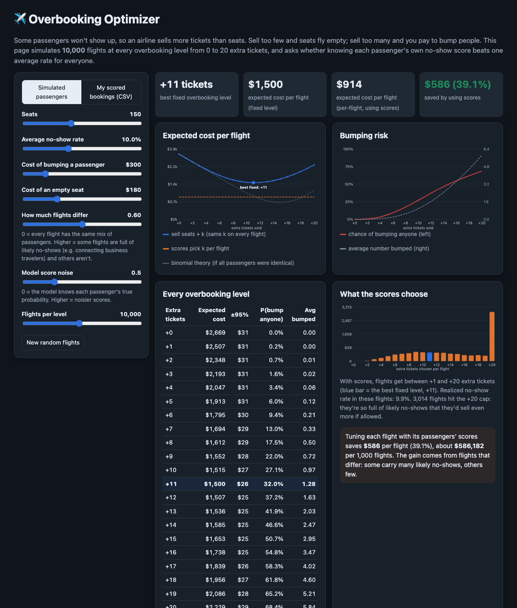

# Overbooking Optimizer ✈️

HW4 Part 4 taken all the way to the decision Larkspur actually cares about: **how many extra tickets should we sell on a 150-seat flight?** This interactive Monte Carlo tool simulates 10,000 flights at every overbooking level from 0 to 20.

For each level it charts:
- **expected cost:** $300 per bumped passenger plus $180 per empty seat
- **the chance of bumping anyone**
- **the average number bumped**

It also compares one average no-show rate for everyone against **individual model scores**.



## Use it

Open `index.html`. The sliders cover:
- seats, average no-show rate, bump cost and empty-seat cost
- **how much flights differ:** some flights carry many likely no-shows, others few
- **model score noise:** how well the model knows each passenger
- flights per level

**"My scored bookings (CSV)"** loads any file with `score` and `no_show` columns, such as the HW4 no-show scores. Each flight then draws real bookings with their real outcomes. The file never leaves your browser and isn't in this repo.

## Method

- **Simulation:** each flight has seats + 20 potential passengers in booking order. Selling seats + k tickets means the first seats + k board. Bumped = max(0, shows − seats), empty seats = max(0, seats − shows).
- **Common random numbers:** the same flights are reused at every level, so the cost curve is smooth and differences between levels are real.
- **Fixed level:** the single k with the lowest average cost across all flights, which is the best any one rule can do.
- **Per-flight policy with scores:** before each flight, compute the exact distribution of no-shows among its passengers from their scores (Poisson-binomial, built one passenger at a time). Then pick that flight's cost-minimizing k, and score the choice on the real outcomes.
- **Newsvendor intuition:** sell one more ticket while P(the others fill the plane) < empty cost / (empty + bump cost) = 180/480 = 0.375.

## What it shows

| Situation | Result |
|---|---|
| Identical passengers, 10% no-shows | best level **+15**, matching exact binomial theory |
| Flights that differ, decent scores (defaults) | per-flight scores cut cost by about **39%** |
| Flights that all look alike | scores add nothing: the total is already predictable |
| Very noisy scores | the gain disappears and can turn into a loss |
| HW4 scored bookings (local test) | best fixed +15 at $692/flight; per-flight scores **$522/flight** |

Heterogeneity also lowers the best *fixed* level (+11 instead of +15). When some flights are full of no-shows and others aren't, total shows are less predictable, so a single rule has to be more cautious.

## Tests

```
node test.mjs
```

There are 11 checks:
- **Binomial theory:** simulation matches the exact binomial cost at all 21 levels, and the optimum is the same.
- **Newsvendor rule:** the optimum obeys it, and higher bump costs mean fewer extra tickets.
- **Poisson-binomial costs:** equal the binomial formula when scores are equal, and match brute-force enumeration on a tiny flight.
- **When scores help:** identical flights gain nothing (gap $0.0), different flights gain about 31%, and noisy scores gain less.
- **Monotonic risk:** bump risk rises with k.
- **Speed:** about 0.35 s for 10,000 flights × 21 levels plus the score policy.
- **HW4 bookings:** if the CSV is present locally, the HW4-bookings result is printed.
